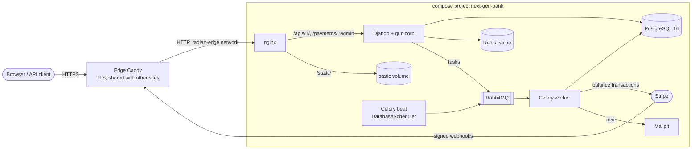
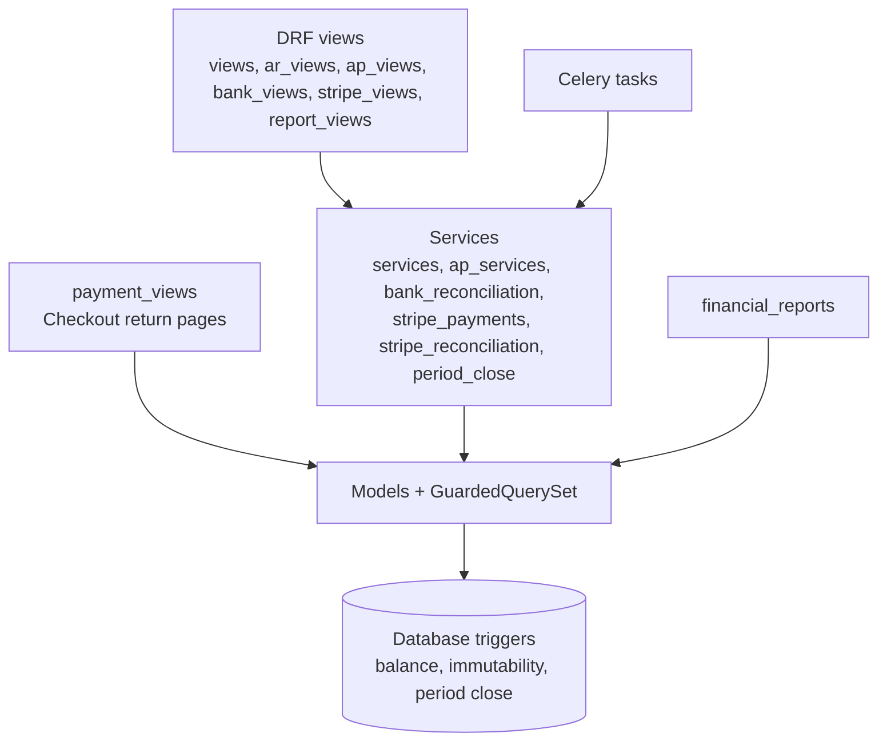
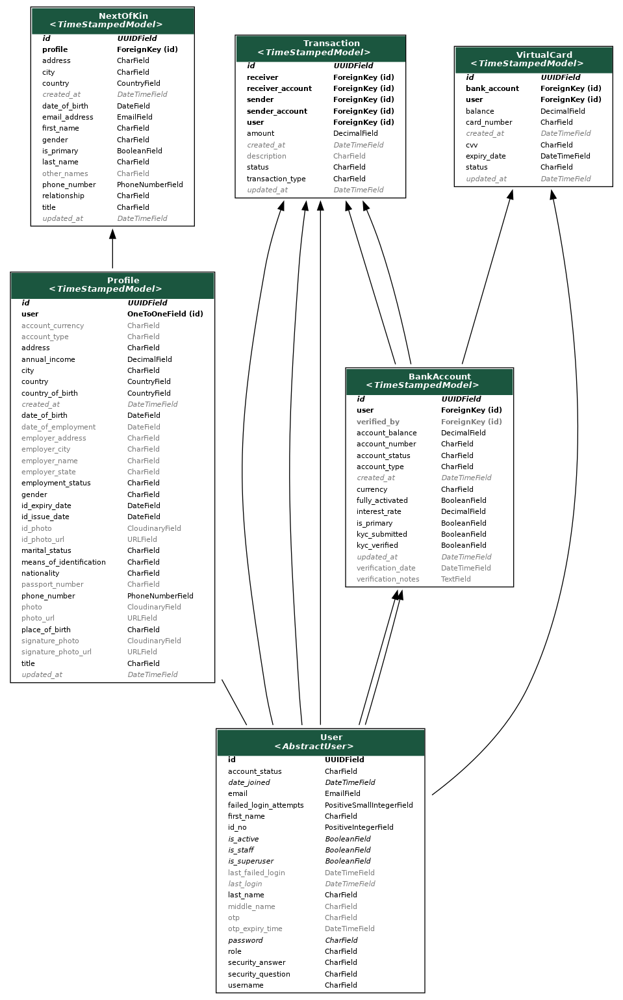
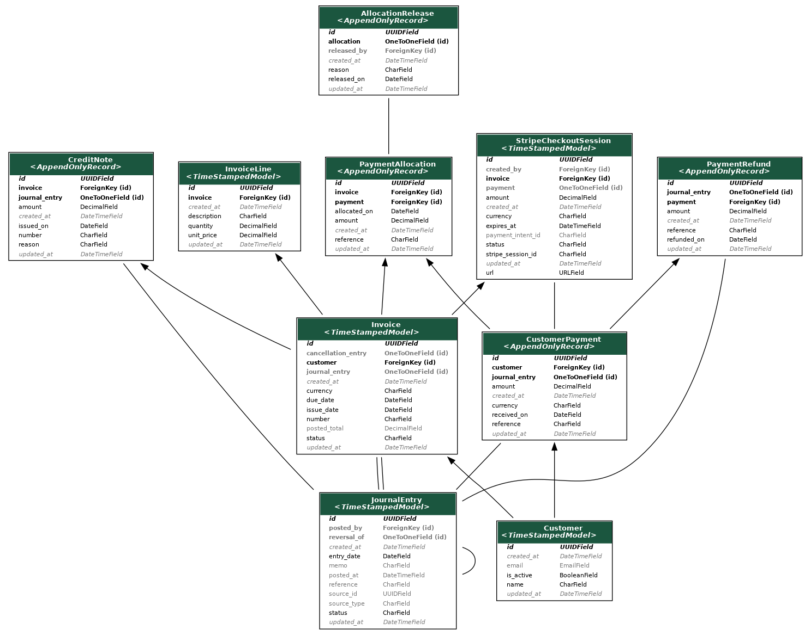
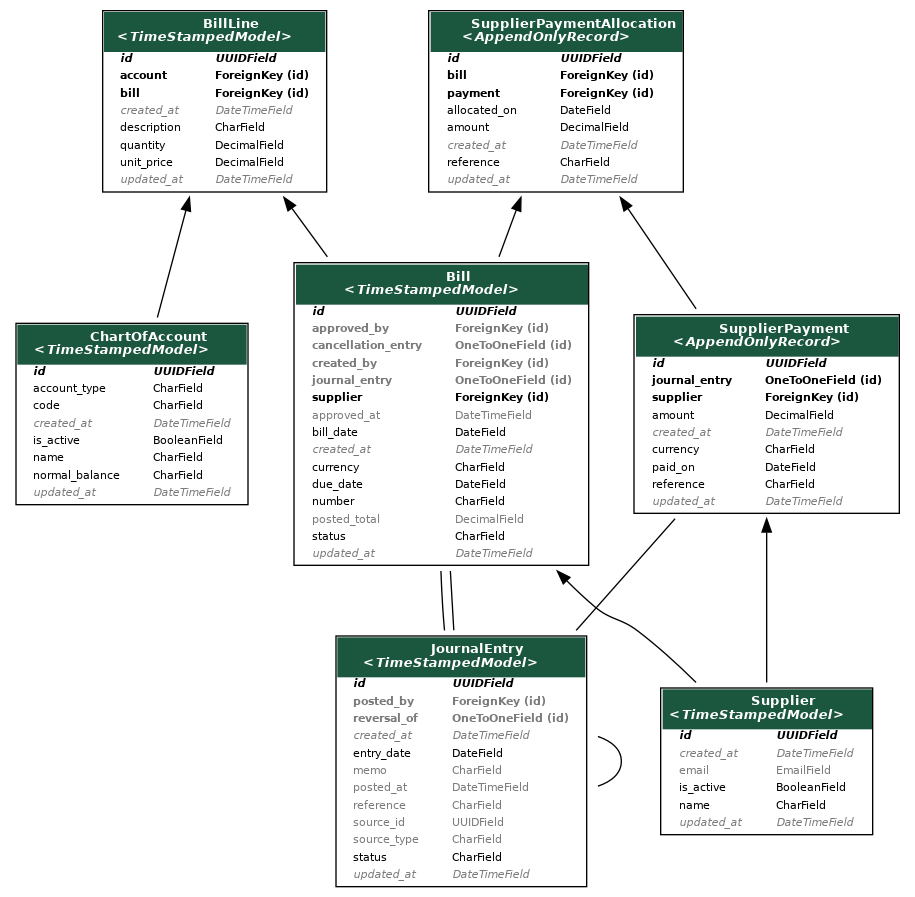
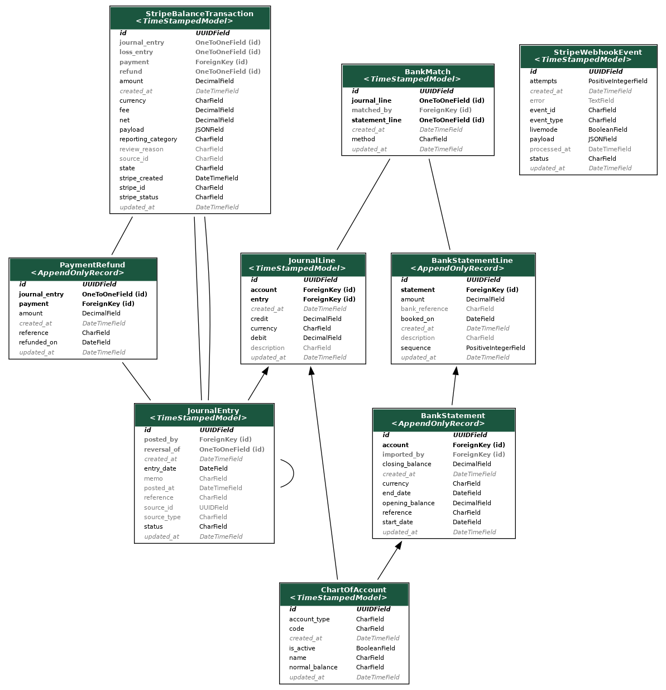
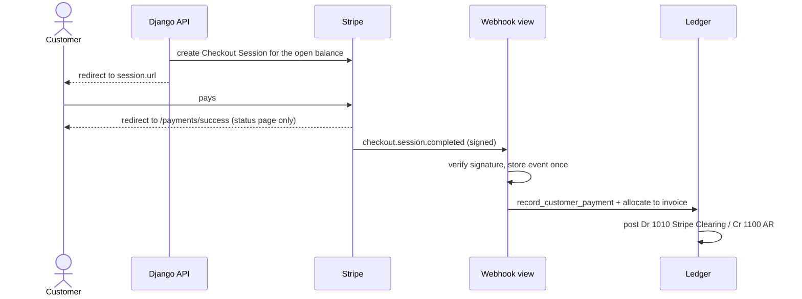
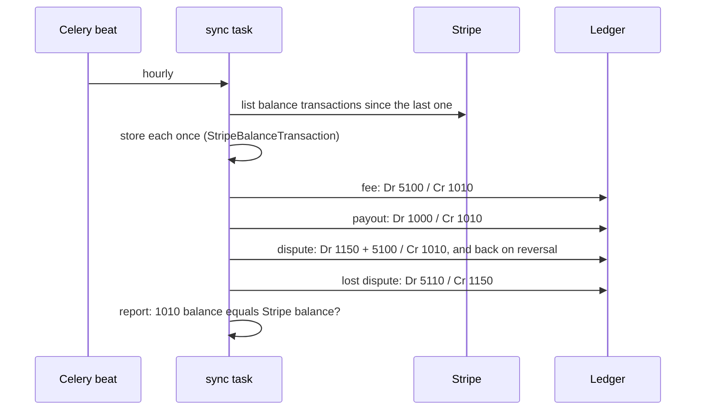

# Architecture and Design

How NextGen Bank is put together: the runtime, the Django apps, the data model,
the main money flows and the rules the database enforces. The detailed
behaviour of each area is in the topic documents listed at the end.

## Runtime



- **Edge**: Caddy terminates TLS and is the only container that publishes public
  ports. nginx serves static files and proxies the rest. Django trusts
  `X-Forwarded-Proto` from nginx (`SECURE_PROXY_SSL_HEADER`). See
  [DEPLOYMENT.md](DEPLOYMENT.md).
- **Database**: PostgreSQL is the system of record. Accounting rules are
  enforced twice: in the service layer and in database triggers and
  constraints. Tests run on SQLite (`make test`) and PostgreSQL
  (`make test-postgres`), and both have the triggers.
- **Background work**: Celery with RabbitMQ as the broker. The beat schedule
  lives in the database (`django_celery_beat`). Static entries come from
  `CELERY_BEAT_SCHEDULE` and the Stripe sync is added by
  `manage.py schedule_stripe_sync`.

### Scheduled jobs

| Job | When | Task |
| --- | --- | --- |
| Savings interest | Daily, 00:00 UTC | `core_apps.accounts.tasks.apply_daily_interest` |
| Suspicious-activity check | Hourly, at :05 | `core_apps.accounts.tasks.detect_suspicious_activities` |
| Stripe balance sync | Hourly by default | `sync_stripe_balance_transactions` |

The suspicious-activity check looks back `TIME_WINDOW_HOURS` (default 1, the
same as its schedule). It flags transactions of at least
`LARGE_TRANSACTION_THRESHOLD` (10000), users with `FREQUENT_TRANSACTION_THRESHOLD`
(10) or more transactions, and accounts whose net change exceeds the large
threshold. It sends one alert email per run.

## Django apps

| App | Responsibility |
| --- | --- |
| `user_auth` | Custom `User`, OTP login, lockout, JWT cookies |
| `user_profile` | KYC profile and next of kin |
| `accounts` | Retail bank accounts, transfers, deposits, statements, interest |
| `cards` | Virtual cards funded from bank accounts |
| `common` | Shared base models and content views |
| `accounting` | General ledger, AR, AP, bank and Stripe reconciliation, reports |

The retail apps (`accounts`, `cards`) keep balances on the row. The
`accounting` app follows the opposite rule: balances are always derived from
posted journal lines and never stored.

### Layers in `accounting`



- **Views** check permissions (`permissions.py`, roles in `roles.py`) and
  call one service function.
- **Services** own every write. They take row locks in a fixed order, are
  idempotent on retries, and record an `AuditEvent` through `audit()`.
- **Models**: append-only models (`AppendOnlyRecord`) refuse updates and
  deletes, and `GuardedQuerySet` blocks bulk writes that would bypass the
  services.
- **Database triggers** reject anything the services would reject, so raw SQL
  cannot unbalance the books either.

## Data model

The images are generated from the models by django-extensions `graph_models`.
Regenerate them after changing a model:

```sh
make diagrams
```

Abstract base classes are hidden. Bold fields are relations and grey fields
can be blank.

### Banking (retail apps)



### General ledger


- `JournalEntry` is a draft until posted. Once posted it is immutable and
  is corrected only by a reversal entry (`reversal_of`).
- `JournalLine` has either a debit or a credit. A posted entry's lines balance
  per currency.
- `PeriodClose` sets `closed_through`. Nothing can be dated on or before it.
  A year-end close can also post the closing entry that moves profit to
  retained earnings (3000).
- `AuditEvent` records who did what for every service call.

### Accounts receivable



- A posted `Invoice` has a journal entry (Dr 1100 AR / Cr 4000 revenue), and a
  cancellation adds a reversing `cancellation_entry`.
- A `CustomerPayment` (Dr cash or 1010 / Cr 1100) is applied to invoices
  through `PaymentAllocation`s. Allocations move no money between accounts,
  so they have no journal entry.
- `AllocationRelease` takes an allocation back in full. Open balances and
  aging count only allocations without a release.
- `PaymentRefund` and `CreditNote` post their own entries.
- `StripeCheckoutSession` links a Checkout Session to the invoice and, once
  the webhook confirms it, to the payment.

### Accounts payable



Bills go from draft to approved to posted (Dr expense lines / Cr 2000 AP).
Supplier payments (Dr 2000 / Cr 1000) are allocated to bills.

### Bank and Stripe reconciliation



- `BankStatement` and its lines are imported from CSV. A `BankMatch` pairs a
  statement line with one ledger `JournalLine`.
- `StripeWebhookEvent` stores each event once, keyed by event ID.
- `StripeBalanceTransaction` mirrors Stripe's balance history and points to
  the entry it posted (fees, payouts, disputes) or to `loss_entry` for a lost
  dispute.

## Main flows

### Customer pays an invoice with Stripe Checkout



The return page only shows status. Fulfilment happens in the webhook, which is
idempotent: a repeated event posts nothing new.

### Stripe balance sync



Anything the sync cannot classify is stored as `needs_review` and nothing is
posted for it.

### Month end

1. Import bank statements, then auto-match and match the remaining lines by hand.
2. Post the unmatched lines (bank fees, interest) with `post_statement_line`.
3. Check the reports: trial balance, AR and AP aging, the Stripe report.
4. Close the period. From then on, any entry dated in the closed period is
   rejected by both the services and the database.

## Design decisions

- **Ledger is the source of truth.** Stripe processes payments but the books
  live in PostgreSQL. Stripe Clearing (1010) is reconciled against the Stripe
  balance.
- **Append-only records.** Posted records are never updated in place; changes
  are new rows (reversals, releases, credit notes), so history is a log.
- **Defence in depth.** Each invariant is checked in Python and in the database.
- **No VAT.** Invoices carry no tax lines (MONEY-01).
- **Restricted Stripe keys.** The key is checked once per process against
  `STRIPE_ACCOUNT_ID`, so a key from the wrong sandbox fails fast.

## Further reading

- [ACCOUNTING_PLATFORM_PLAN.md](ACCOUNTING_PLATFORM_PLAN.md): goals and phases
- [LEDGER_API.md](LEDGER_API.md), [AR_WORKFLOWS.md](AR_WORKFLOWS.md), [AP_WORKFLOWS.md](AP_WORKFLOWS.md)
- [BANK_RECONCILIATION.md](BANK_RECONCILIATION.md), [STRIPE_PAYMENTS.md](STRIPE_PAYMENTS.md), [FINANCIAL_REPORTS.md](FINANCIAL_REPORTS.md)
- [DEPLOYMENT.md](DEPLOYMENT.md), [ENGINEERING_FOLLOW_UPS.md](ENGINEERING_FOLLOW_UPS.md)
