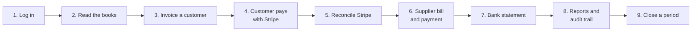

# Demo Walkthrough

A guided tour of the live demo, about 20–30 minutes. It follows money through
the books: bill a customer, take a Stripe payment, record a supplier bill, match
the bank statement, read the reports and close a period. Every step says what to
expect.

**Live demo:** https://next-gen-bank.srv1915831.hstgr.cloud

> This is a demo: Stripe runs in a sandbox (no real money), and all email is
> caught by Mailpit. See [PROJECT_OVERVIEW.md](PROJECT_OVERVIEW.md) for what the
> project is, and [LEDGER.md](LEDGER.md) for the accounting behind each step.



## Before you start

You need:
- **A superuser login.** If you don't have one yet, create it on the server:
  ```sh
  cd /root/dev/banking/nextgen-bank && make prod-manage cmd=createsuperuser
  ```
  At the security-question prompt, type a code such as `favorite_color`, not
  the question itself.
- **An SSH tunnel to Mailpit.** Login sends a one-time code by email, and the
  demo's email lands in Mailpit, which is only reachable over the tunnel:
  ```sh
  ssh -N -L 8026:localhost:8026 -L 5556:localhost:5556 root@185.166.39.74
  ```
  Then open http://localhost:8026 for Mailpit and http://localhost:5556 for
  Flower, which shows the background tasks.
- **For step 6 only, a second user.** A bill must be approved by someone other
  than the person who entered it (segregation of duties). Create one in the
  admin at `/supersecret/`, under Users, and add them to the **AP approver**
  group.

### How to send requests
Open the site root, which redirects to the **API docs (Swagger)**. Every request
below can be run there:
1. Find the endpoint and click **Try it out**.
2. Paste the JSON body.
3. Click **Execute**.

After you log in (step 1), the browser holds a login cookie and Swagger sends it
automatically. You can also open any `GET` URL directly in a browser tab to
see its JSON.

All accounting routes start with `/api/v1/accounting/`. Replace `<today>` with
today's date (`YYYY-MM-DD`) and `<id>` with the IDs that earlier responses
return.

## 1. Log in

1. `POST /api/v1/auth/login/`
   ```json
   {"email": "you@example.com", "password": "your password"}
   ```
   Expect: `"OTP sent to your email"`.
2. Open Mailpit (http://localhost:8026) and copy the 6-digit code. It expires
   after **1 minute** on the demo.
3. `POST /api/v1/auth/verify-otp/`
   ```json
   {"otp": "123456"}
   ```
   Expect: `"Login successful"`. You are now signed in, and the cookie lasts
   until you log out.

## 2. Read the books

| Request | What you see |
| --- | --- |
| `GET accounts/` | The chart of accounts: 1000 Cash, 1010 Stripe Clearing, 1100 AR … 5110 Chargeback Losses |
| `GET trial-balance/` | Every account with a balance, and `"balanced": true` |
| `GET entries/` | The journal: each entry with its debit and credit lines |

The demo already contains invoice **DEMO-1** (120.00 EUR), paid through Stripe.
In the trial balance, Stripe Clearing (1010) shows 115.97 after Stripe's 4.03
fee. Point out that every number comes from journal entries; none is stored.

### Or browse it in the admin

The admin at https://next-gen-bank.srv1915831.hstgr.cloud/supersecret/ (log in
with your superuser; no one-time code needed) has a read-only **Accounting**
section, the easiest way to look around:
- invoices with their lines, allocations and credit notes inline;
- journal entries with their debit and credit lines;
- payments, Stripe sessions and webhook events, bank statements, bills;
- the audit trail.

Every list can be searched and filtered. Nothing can be added, changed or
deleted there, because all writes go through the API so they are validated
and audited. Keep a tab open on it during the walkthrough to watch each step
appear.

## 3. Invoice a customer

1. **Create the customer:** `POST customers/`
   ```json
   {"name": "Acme Studio", "email": "billing@acme.example"}
   ```
   Keep the returned `id`.
2. **Draft the invoice:** `POST invoices/`
   ```json
   {
     "customer": "<customer id>",
     "number": "DEMO-2",
     "issue_date": "<today>",
     "due_date": "<today + 14 days>",
     "lines": [
       {"description": "Bookkeeping setup", "quantity": "1", "unit_price": "250.00"},
       {"description": "Monthly close support", "quantity": "2", "unit_price": "75.00"}
     ]
   }
   ```
   Expect: status `draft`, total 400.00. **Nothing is in the books yet.**
   Drafts can still be edited or deleted.
3. **Post it:** `POST invoices/<id>/post/` with an empty body.

   Expect: status `posted`, open balance 400.00, and a `journal_entry` ID.
4. `GET entries/<journal_entry id>/` shows **Dr 1100 Accounts Receivable
   400.00 / Cr 4000 Sales Revenue 400.00**.

Things to show:
- Try `POST invoices/<id>/post/` again. It's refused, because a posted invoice
  can't be posted twice.
- Repeat the draft request with the same number. It's refused, because invoice
  numbers are unique.

## 4. The customer pays with Stripe

1. `POST invoices/<id>/checkout/` with an empty body.

   Expect: a `url` on `checkout.stripe.com`, for the open balance of 400.00.
2. Open the URL and pay with test card **4242 4242 4242 4242**, any future
   expiry date, any CVC and any name.
3. Stripe sends you back to the demo's **payment page**. It shows "confirming"
   for a moment, then **paid** once Stripe's signed webhook has arrived.
4. Check the result:
   - `GET invoices/<id>/` shows an open balance of 0.00;
   - `GET payments/` shows a payment with reference `stripe:pi_…`;
   - its entry is **Dr 1010 Stripe Clearing 400.00 / Cr 1100 AR 400.00**.

Things to show:
- **The return page doesn't record the payment; only the signed webhook does.**
  Reloading the page or replaying the webhook never pays an invoice twice.
- If the webhook never arrives, `recover_checkout_sessions` asks Stripe about
  the session during the hourly sync and records it. See
  [STRIPE_PAYMENTS.md](STRIPE_PAYMENTS.md#missed-webhooks).

## 5. Reconcile Stripe

1. `POST stripe/balance-transactions/sync/` with an empty body.

   Expect: the new charge is listed and its Stripe fee posted
   (**Dr 5100 Fees / Cr 1010**).
2. `GET stripe/reconciliation/`

   Expect: `ledger_balance` equals `stripe_balance`, `difference` is 0.00 and
   `reconciled` is `true`.

This proves the books agree with what Stripe holds. The same sync also runs
every hour (watch it in Flower), and it posts payouts and disputes too.

## 6. A supplier bill and its payment

1. **Create the supplier:** `POST suppliers/`
   ```json
   {"name": "CloudHost Ltd", "email": "invoices@cloudhost.example"}
   ```
2. **Enter the bill:** `POST bills/`
   ```json
   {
     "supplier": "<supplier id>",
     "number": "CH-1001",
     "bill_date": "<today>",
     "due_date": "<today + 30 days>",
     "lines": [{"account": "5000", "description": "Hosting, this month", "quantity": "1", "unit_price": "60.00"}]
   }
   ```
3. **Approve it as the second user.** Log out (`POST /api/v1/auth/logout/`), log
   in as the AP approver, then `POST bills/<id>/approve/`.

   Approving as the same user who entered the bill is refused. That's the
   segregation-of-duties control.
4. **Post it:** `POST bills/<id>/post/`, as either user with posting rights.

   Expect: **Dr 5000 Operating Expenses 60.00 / Cr 2000 Accounts Payable 60.00**.
5. **Pay the supplier:** `POST supplier-payments/`
   ```json
   {
     "supplier": "<supplier id>",
     "reference": "BANK-TRF-1",
     "amount": "60.00",
     "paid_on": "<today>",
     "allocations": [{"bill": "<bill id>", "amount": "60.00", "reference": "PAY-CH-1001"}]
   }
   ```
   Expect: **Dr 2000 AP / Cr 1000 Cash 60.00**, and `GET ap-aging/` no longer
   lists the bill.

## 7. Match the bank statement

The supplier payment left the bank, and the bank also charged a fee. Save this
as `statement.csv`:

```csv
date,amount,description,reference
<today>,-60.00,Transfer to CloudHost Ltd,BANK-TRF-1
<today>,-2.50,Monthly account fee,FEE-1
```

1. `POST bank-statements/import-csv/` as a multipart form (Swagger shows a file
   picker):

   | Field | Value |
   | --- | --- |
   | `file` | `statement.csv` |
   | `reference` | `STMT-1` |
   | `start_date`, `end_date` | `<today>` |
   | `opening_balance` | the bank balance before these lines: `0.00` on a fresh demo |
   | `closing_balance` | opening − 62.50, so `-62.50` on a fresh demo |

   Expect: the −60.00 line is **matched automatically** to the supplier payment
   (same amount, date and reference). The −2.50 fee stays unmatched, because
   the ledger doesn't know about it yet.
2. **Post the bank-only fee:** `POST bank-lines/<fee line id>/post/`
   ```json
   {"account": "5000", "memo": "Bank account fee"}
   ```
   Expect: **Dr 5000 / Cr 1000 2.50**, and the line is matched.
3. `GET bank-reconciliation/?as_of=<today>` shows the ledger and the bank
   agree.

Things to show:
- Opening plus lines must equal closing, or the import is refused.
- Posting the fee to a control account such as 1100 AR is refused; customer
  receipts go through payments.

## 8. Reports and the audit trail

| Request | What it shows |
| --- | --- |
| `GET trial-balance/` | Everything still balances |
| `GET profit-and-loss/?start_date=<first of month>&end_date=<today>` | Sales 520.00, minus Stripe fees, hosting and the bank fee |
| `GET balance-sheet/?as_of=<today>` | Assets = liabilities + equity, with this year's profit under equity |
| `GET ar-aging/?as_of=<today>` | Nothing overdue: every invoice is paid |
| `GET customers/<id>/statement/?start_date=…&end_date=…` | The customer's invoice and payment, with a running balance |
| `GET audit-events/` | Who drafted, posted, approved and paid what, and when |

## 9. Close a period

Closing locks the books through a date. **This is permanent**, so close a date
**before** the demo's first entry, such as the last day of the previous month,
or you won't be able to post today's entries anymore.

1. `POST periods/`
   ```json
   {"through": "<last day of previous month>"}
   ```
2. Try to record something dated in the closed period, for example
   `POST payments/` with `"received_on"` inside it.

   Expect: **400**, "The books are closed through …". Corrections go in the
   next open period. The database enforces this too, not just the API.

For a year end, `"transfer_earnings": true` first posts the closing entry that
moves income and expenses into 3000 Retained Earnings.

## Corrections (optional)

Nothing posted is ever edited. Show how mistakes are fixed instead:

| Mistake | Request | Effect |
| --- | --- | --- |
| Invoice raised in error (unpaid) | `POST invoices/<id>/cancel/` `{"cancellation_date": "<today>"}` | A reversal entry; both entries stay in the journal |
| Payment applied to the wrong invoice | `POST allocations/<id>/release/` `{"released_on": "<today>", "reason": "Wrong invoice"}` | The invoice reopens and the payment becomes credit again; no journal entry |
| Customer overcharged | `POST credit-notes/` `{"number": "CN-1", "invoice": "<id>", "amount": "50.00", "issued_on": "<today>", "reason": "Discount"}` | Dr 4000 / Cr 1100 |

## Troubleshooting

| Symptom | Cause |
| --- | --- |
| `401` on every request | Not logged in, or the login has expired: repeat step 1 |
| `403` | Your user lacks that role; superusers can do everything |
| The OTP is refused | It expired after 1 minute: log in again |
| The payment page stays on "confirming" | The webhook hasn't arrived; the hourly sync recovers it, or ask an operator to run `make prod-manage cmd=recover_stripe_checkouts` |
| `503` on checkout or sync | Stripe isn't configured on the server |
