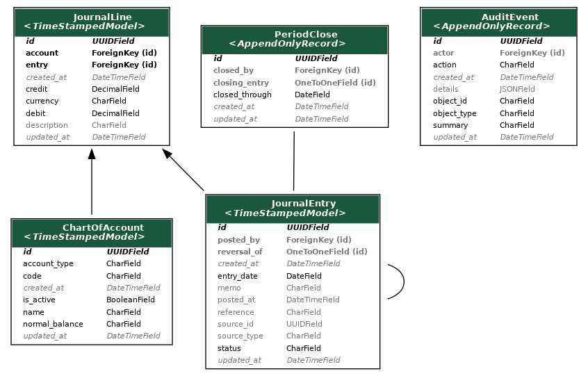
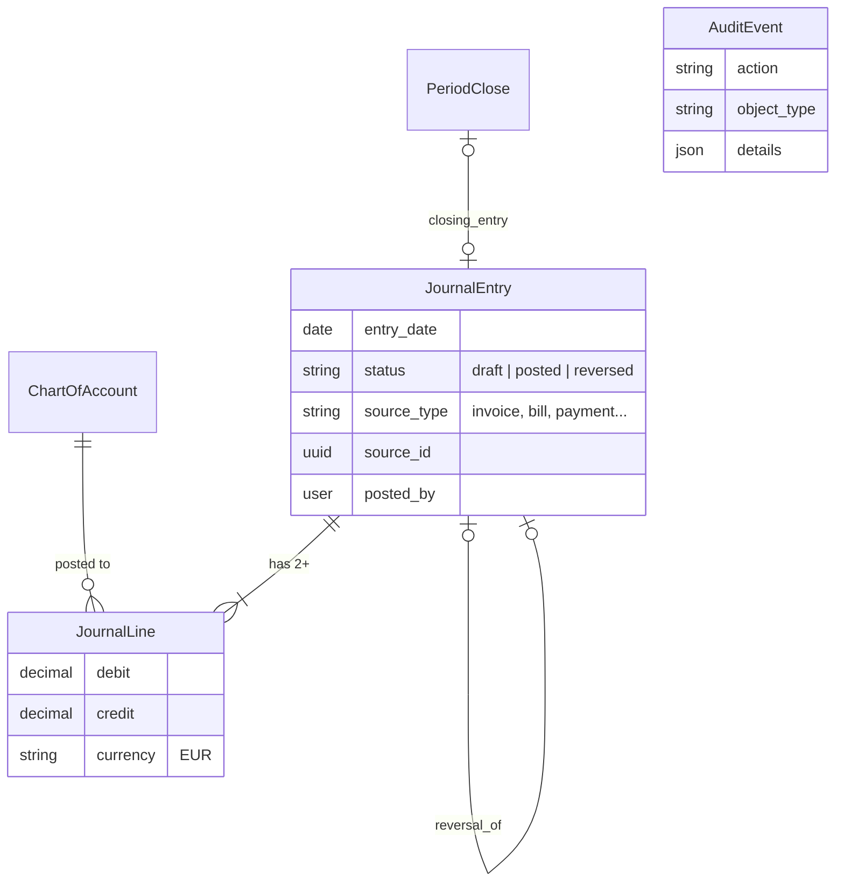
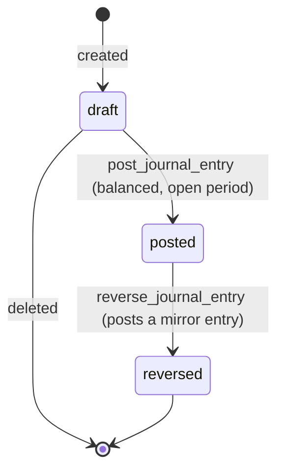
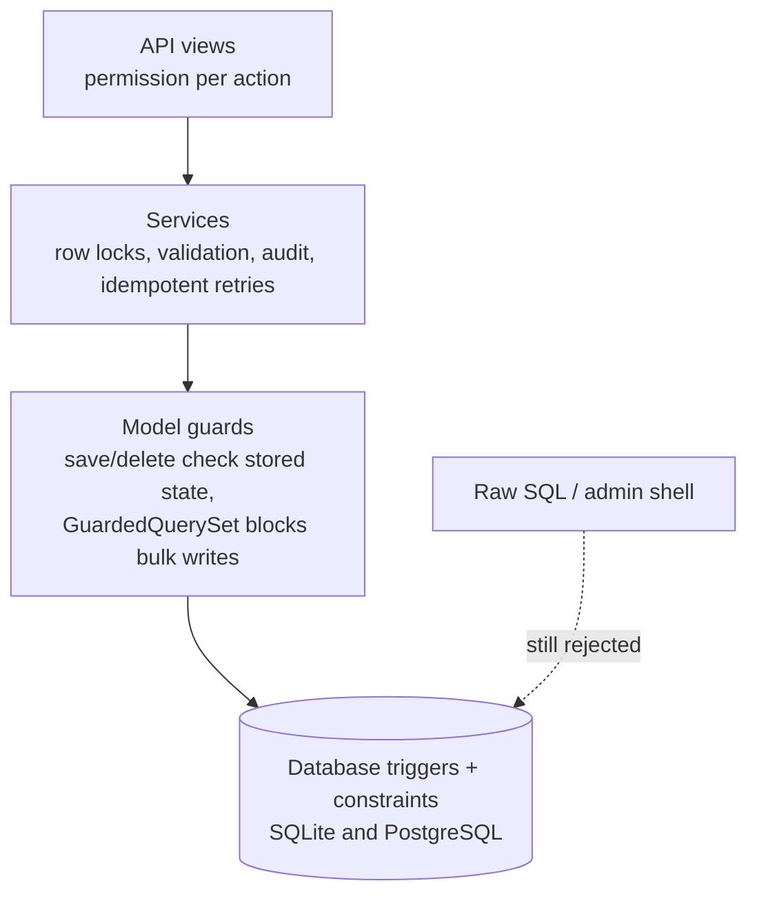

# The Ledger

The ledger is the heart of the accounting platform. Every financial event,
whether an invoice, a Stripe payment, a supplier bill or a bank fee, ends up as
a balanced journal entry here, and every balance and report is computed from
these entries. This document explains how the ledger is designed and why.

For the HTTP routes, see [LEDGER_API.md](LEDGER_API.md). For the wider system,
see [ARCHITECTURE.md](ARCHITECTURE.md).

## Double-entry in one minute

Each entry moves money between at least two accounts. The amounts on the
**debit** side equal the amounts on the **credit** side, so the books always
balance.

| Account type | Grows with | Example |
| --- | --- | --- |
| Asset | Debit | Cash, money owed by customers |
| Expense | Debit | Fees, chargeback losses |
| Liability | Credit | Money owed to suppliers |
| Equity | Credit | Retained earnings |
| Income | Credit | Sales |

`ChartOfAccount.normal_balance` is derived from the type and cannot be set by
hand.

## Chart of accounts

Seeded by migrations `0002` and `0016`:

| Code | Name | Type | Used for |
| --- | --- | --- | --- |
| 1000 | Cash and Bank | Asset | Bank receipts, supplier payments, Stripe payouts |
| 1010 | Stripe Clearing | Asset | Money held by Stripe before payout |
| 1100 | Accounts Receivable | Asset | What customers owe |
| 1150 | Disputed Stripe Payments | Asset | Money Stripe withheld for a dispute |
| 2000 | Accounts Payable | Liability | What we owe suppliers |
| 2100 | Tax Payable | Liability | Unused; no VAT (MONEY-01) |
| 3000 | Retained Earnings | Equity | Year-end profit transfer |
| 4000 | Sales Revenue | Income | Posted invoices |
| 5000 | Operating Expenses | Expense | Supplier bills, bank charges |
| 5100 | Payment Processing Fees | Expense | Stripe fees |
| 5110 | Chargeback Losses | Expense | Lost disputes |

1000, 1010, 1100, 1150 and 2000 are **control accounts**. Only their own
workflows may post to them; a bank statement line, for example, cannot be
posted to AR by hand.

## Data model

- **`JournalEntry`** is the header: date, memo, status, and which business
  document created it (`source_type` + `source_id`).
- **`JournalLine`** has one account and exactly one positive side, either a
  debit or a credit.
- **`PeriodClose`** records that the books are closed through a date.
- **`AuditEvent`** records every service action: who did it, to what, and the
  details.

There is one currency: **EUR**, the Stripe account's settlement currency
(MONEY-01). Amounts are `Decimal` with two places; floats are rejected.

## Entry lifecycle

- **Draft:** lines can be added, changed or removed, and the entry can be
  deleted.
- **Posted:** immutable. The entry and its lines can never change or be deleted.
- **Reversed:** still immutable. A second, mirror entry (`reversal_of`) cancels
  it, and both stay in the books so the history is visible.

Posting (`services.post_journal_entry`) checks, under a row lock, that:
1. the entry is still a draft;
2. it has lines, all in one currency;
3. its date is after the last period close;
4. total debits equal total credits.

Business services don't build entries by hand. They call
`post_lines([(code, debit, credit), ...])`, which creates the draft and posts
it in one transaction.

## What posts what

| Business event | Debit | Credit | Code |
| --- | --- | --- | --- |
| Invoice posted | 1100 AR | 4000 Sales | `post_invoice` |
| Invoice cancelled | reversal of the invoice entry | | `cancel_invoice` |
| Customer pays by bank | 1000 Cash | 1100 AR | `record_customer_payment` |
| Customer pays by Stripe | 1010 Stripe Clearing | 1100 AR | webhook, `recover_checkout_sessions` |
| Payment applied to invoice | *no entry* | | `allocate_payment` |
| Allocation released | *no entry* | | `release_allocation` |
| Refund of unapplied credit | 1100 AR | 1000 or 1010 | `refund_payment` |
| Credit note | 4000 Sales | 1100 AR | `issue_credit_note` |
| Supplier bill posted | expense line accounts | 2000 AP | `post_bill` |
| Supplier paid | 2000 AP | 1000 Cash | `record_supplier_payment` |
| Stripe fee | 5100 Fees | 1010 | Stripe sync |
| Stripe payout | 1000 Cash | 1010 | Stripe sync |
| Dispute opened | 1150 Disputed (+ 5100 fee) | 1010 | Stripe sync |
| Dispute won | 1010 | 1150 | Stripe sync |
| Dispute lost | 5110 Chargeback Losses | 1150 | Stripe sync |
| Bank-only item (charge, interest) | chosen account or 1000 | 1000 or chosen account | `post_statement_line` |
| Year-end close | income accounts / 3000 | 3000 / expense accounts | `close_period(transfer_earnings=True)` |

Allocations and releases have no entry because they move nothing between
accounts. The payment already credited AR as a whole, and an allocation only
records which invoice it settles.

### Worked example: the demo's first payment

Invoice DEMO-1 for 120.00 EUR was paid through Stripe Checkout, and Stripe kept
a 4.03 fee:

| Entry | Account | Debit | Credit |
| --- | --- | ---: | ---: |
| Invoice posted | 1100 Accounts Receivable | 120.00 | |
| | 4000 Sales Revenue | | 120.00 |
| Stripe payment | 1010 Stripe Clearing | 120.00 | |
| | 1100 Accounts Receivable | | 120.00 |
| Stripe fee (sync) | 5100 Payment Processing Fees | 4.03 | |
| | 1010 Stripe Clearing | | 4.03 |

Afterwards AR is 0, so the invoice is settled. Stripe Clearing is 115.97,
exactly the banking-demo balance, so it's reconciled. Income is 120.00 and
expenses 4.03. When Stripe pays out, 115.97 moves from 1010 to 1000.

## How integrity is protected

The rules are enforced at every layer, so a bug or a raw SQL statement can't
unbalance the books.

- **Balanced on posting:** a trigger refuses to set an entry to `posted` unless
  it has two or more lines and debits equal credits.
- **Immutable history:** triggers reject updates and deletes of posted entries
  and their lines. The only allowed change is `posted → reversed`, and only once
  a reversal exists.
- **One side per line:** a check constraint requires exactly one positive side.
- **Stable accounts:** an account with posted lines keeps its code and type. It
  can be renamed or deactivated.
- **Closed periods:** triggers refuse posting an entry, or releasing an
  allocation, dated on or before the last close.
- **No bulk writes:** `GuardedQuerySet` refuses `update()`, `delete()` and
  `bulk_*()`, which would skip validation.
- **Stale objects:** `save()` rereads the stored row, so an old in-memory copy
  can't overwrite a posted entry.
- **Concurrency:** posting and line edits lock the entry row in the same order,
  and settlement services lock payment, then invoice. PostgreSQL tests
  (`make test-postgres`) run real concurrent transactions against these locks.
- **Idempotency:** retried requests with the same reference return the original
  record. A reference reused with different details is refused. Stripe events
  and balance transactions are stored once by their Stripe ID.

Migration `0013_ledger_integrity` installs the ledger triggers; `0005`, `0006`,
`0012`, `0014` and `0015` do the same for AR, AP, period close and allocation
releases.

## Corrections

Posted entries are never edited:
- **Wrong entry:** `reverse_journal_entry` posts the mirror entry and marks the
  original reversed.
- **Wrong invoice or bill:** cancel it. Its entry is reversed on the
  cancellation date.
- **Payment on the wrong invoice:** release the allocation and allocate it again.
- **Customer overcharged:** issue a credit note, or refund the unapplied credit.

## Period close

`close_period(through=date)` (`POST /api/v1/accounting/periods/`):
- refuses if draft entries are dated in the period;
- records `PeriodClose`, after which nothing can be dated on or before
  `closed_through`, whether through a service or raw SQL;
- with `transfer_earnings=True` (a year end), first posts the closing entry,
  which moves every income and expense balance into 3000 Retained Earnings.

Closing is final. A correction is posted in the next open period.

## Reports

All reports are computed from posted lines on request, so nothing is cached and
nothing can drift. Reversed entries stay included: they and their reversal
cancel each other out.

| Report | Route | Shows |
| --- | --- | --- |
| General ledger | `general-ledger/` | Every posted line, filterable by date and account |
| Trial balance | `trial-balance/` | Net debit or credit per account, plus a `balanced` flag |
| Balance sheet | `balance-sheet/` | Assets = liabilities + equity (including current profit) as of a date |
| Profit and loss | `profit-and-loss/` | Income minus expenses for a period |
| AR / AP aging | `ar-aging/`, `ap-aging/` | Open invoices and bills by days overdue |
| Customer / supplier statement | `customers/<id>/statement/`, `suppliers/<id>/statement/` | Movements and running balance |
| Bank / Stripe reconciliation | `bank-reconciliation/`, `stripe/reconciliation/` | Ledger vs bank / Stripe balance |
| Audit trail | `audit-events/` | Who did what, when |

## Access

Finance roles are Django groups created by
`python manage.py setup_accounting_roles`:
- **Accounting viewer:** read-only.
- **AR clerk / AR manager:** create invoices, then post them.
- **AP clerk / AP approver:** enter bills, then approve and post them.
- **Reconciler:** bank and Stripe matching.
- **Controller:** everything, plus period close.

Each action needs its own permission, and staff status alone grants nothing.

## Where the code is

| File | What |
| --- | --- |
| `core_apps/accounting/models.py` | Chart, entries, lines, guards, all documents |
| `core_apps/accounting/services.py` | Posting, reversal, AR services, `audit()` |
| `core_apps/accounting/ap_services.py` | Bills and supplier payments |
| `core_apps/accounting/period_close.py` | Period and year-end close |
| `core_apps/accounting/financial_reports.py` | Balance sheet, P&L, statements |
| `core_apps/accounting/migrations/0013_ledger_integrity.py` | Ledger triggers |
| `core_apps/accounting/tests/test_ledger_integrity.py`, `test_period_close.py` | Ledger rules, integrity, concurrency, closing |
