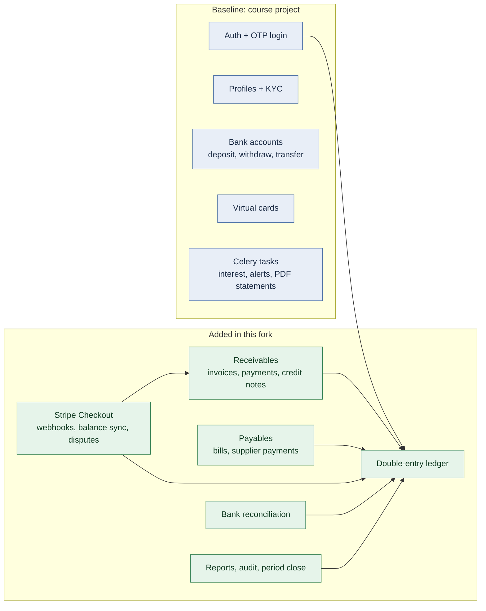
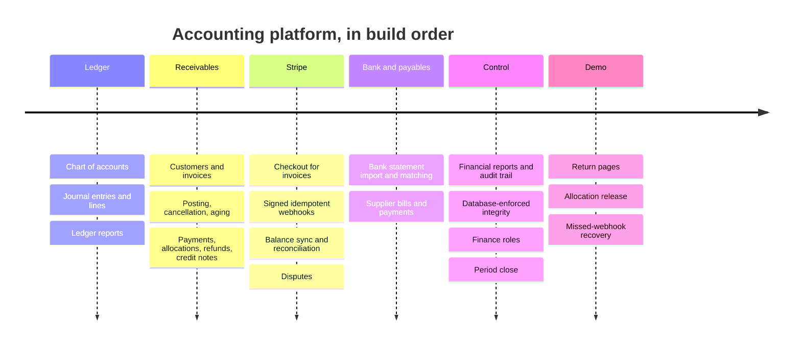

# Project Overview: Before and After

NextGen Bank started as a course project: a Django REST banking backend. On top
of it, this fork adds a full **accounting platform**: a double-entry ledger,
invoicing and payments, supplier bills, Stripe payments, bank reconciliation
and financial reports. It also hardens the original code and deploys the
result as a public demo.

| | Baseline (course) | Additions (this fork) |
| --- | --- | --- |
| Period | Oct–Nov 2024 | Oct 2026 |
| Commits | 29 (`87176ca` … `549ccdb`) | 41+ (`91b6da9` onwards) |
| Main code | `user_auth`, `user_profile`, `accounts`, `cards`, `common` | `core_apps/accounting` (≈10,000 lines, 16 migrations) |
| Tests | none | 328 tests on SQLite and PostgreSQL, run in GitHub Actions |
| Docs | `System Architecture.png` | `docs/` (this folder) |

Related documents:
- [ARCHITECTURE.md](ARCHITECTURE.md): the runtime and the design;
- [LEDGER.md](LEDGER.md): the ledger in depth;
- [DEMO.md](DEMO.md): walkthrough of the live demo.

The accounting app reuses the baseline's user model, JWT cookie login, Celery
and Docker setup. It doesn't touch the retail banking tables; it is a separate
bounded context.

## Part 1: The baseline (course project)

A retail banking API built step by step in a course by API-Imperfect.

### Features
| Area | What it does |
| --- | --- |
| Auth (`user_auth`) | Custom `User` with email login. A one-time code (OTP) is emailed at each login, and JWT goes in HTTP-only cookies. Accounts lock after failed attempts. Roles: customer, teller, account executive, branch manager. |
| Profiles (`user_profile`) | KYC data, ID photos and signature uploaded to Cloudinary, next of kin. |
| Bank accounts (`accounts`) | An account is created for each new user. An account executive verifies and activates it, tellers deposit, customers withdraw and transfer (with OTP). The transaction list can be filtered, and a PDF history is emailed by Celery. |
| Interest | Savings accounts earn daily interest, tiered by balance. |
| Fraud checks | Large or frequent transactions are emailed to the admin. |
| Virtual cards (`cards`) | Create, top up from a bank account, delete. |
| Infrastructure | Docker Compose with nginx, Django, PostgreSQL, Redis, RabbitMQ, Celery worker and beat, Flower, Mailpit, plus Postgres backup and restore scripts and a DigitalOcean deploy script. |

### Data model

### Design notes
- **Balances on the row:** `BankAccount.account_balance` is updated in place,
  and a `Transaction` row records each movement. That's simple and fast, but the
  balance and its history can drift apart, which is the main reason the
  accounting app uses a ledger instead.
- **Logic in views:** most business logic lives in DRF views and serializers.
- **No tests** shipped with the course code.

## Part 2: The additions

### 1. Accounting platform (`core_apps/accounting`)
Built goal by goal from [ACCOUNTING_PLATFORM_PLAN.md](ACCOUNTING_PLATFORM_PLAN.md),
with tests for each goal.

| Area | Highlights | Doc |
| --- | --- | --- |
| Ledger | Balanced, immutable entries; reversals; database triggers | [LEDGER.md](LEDGER.md), [LEDGER_API.md](LEDGER_API.md) |
| Receivables | Draft, post and cancel invoices. Payments are allocated to invoices; allocations can be released; refunds, credit notes, aging. | [AR_WORKFLOWS.md](AR_WORKFLOWS.md) |
| Payables | Bills go draft → approved → posted, then supplier payments and AP aging | [AP_WORKFLOWS.md](AP_WORKFLOWS.md) |
| Stripe | Checkout per invoice, signed webhooks, return pages, recovery of missed webhooks, hourly balance sync (fees, payouts, disputes) | [STRIPE_PAYMENTS.md](STRIPE_PAYMENTS.md) |
| Bank | CSV statement import, automatic and manual matching, posting bank-only items | [BANK_RECONCILIATION.md](BANK_RECONCILIATION.md) |
| Reports | Trial balance, balance sheet, P&L, statements, audit trail, period close | [FINANCIAL_REPORTS.md](FINANCIAL_REPORTS.md) |
| Access | Six finance roles (`setup_accounting_roles`), with a permission per action | [LEDGER.md](LEDGER.md#access) |

Data model by area: [ledger](diagrams/ledger.png),
[receivables](diagrams/receivables.png), [payables](diagrams/payables.png),
[bank and Stripe](diagrams/bank_and_stripe.png). Regenerate them with
`make diagrams`.

**Design choices that differ from the baseline:**
- **Ledger as the source of truth:** balances are always computed from posted
  lines, never stored.
- **Service layer:** every write goes through one service function that locks
  rows, validates, writes an audit event and is safe to retry. Views only check
  permissions and call it.
- **Defence in depth:** each rule holds in Python and again in database
  triggers, on both SQLite and PostgreSQL.
- **Append-only history:** payments, allocations, refunds and closes are never
  edited. A correction is a new record.
- **One currency:** EUR only, and no VAT (MONEY-01).

### 2. Quality and tooling
- **Tests:** 328 pytest tests. `make test` runs them on SQLite, and
  `make test-postgres` runs them on a disposable PostgreSQL 16, including real
  concurrency tests.
- **CI:** GitHub Actions runs the suite on every push.
- **Isolated test settings:** they need no secrets or running services.
- **Reproducible installs:** every transitive dependency is pinned in
  `requirements/constraints.txt`, and the stale Pipfile was removed.
- **Diagrams:** `make diagrams` regenerates the model diagrams
  (django-extensions + Graphviz).
- **Tracking:** known gaps and decisions live in
  [ENGINEERING_FOLLOW_UPS.md](ENGINEERING_FOLLOW_UPS.md).

### 3. Fixes to baseline code
| Problem | Fix |
| --- | --- |
| `DEBUG="False"` in production evaluated as true | Strict boolean parsing (`env_flag`) |
| Celery beat entries had no schedule and wrong task names, so interest and fraud checks never ran | Interest daily at 00:00 UTC, fraud check hourly |
| Fraud check crashed without its env vars, looked at the wrong time window, and emailed after the first account | Defaults, correct window, one alert per run |
| Cloudinary configured before settings finished loading | Configured in `CommonConfig.ready()` |
| Deploy script ran `docker system prune -af` on a shared server | Removed; see [DEPLOYMENT.md](DEPLOYMENT.md) |
| Dev ports published on all interfaces, bypassing the firewall | Bound to 127.0.0.1, reached through an SSH tunnel |

### 4. Deployment
The demo runs at **https://next-gen-bank.srv1915831.hstgr.cloud**, behind a
shared Caddy that also serves other sites on the same server.
- **Web tier:** nginx was removed. Caddy handles TLS and proxies straight to
  gunicorn, and WhiteNoise serves static files.
- **Its own stack:** a separate Compose project (`next-gen-bank`) with its own
  database, broker and Stripe sandbox (`banking-demo`).
- **Secrets:** they live outside the repository, and the Stripe key is a
  restricted key checked against the expected account.

Details: [DEPLOYMENT.md](DEPLOYMENT.md). Runtime diagram:
[ARCHITECTURE.md](ARCHITECTURE.md#runtime).
